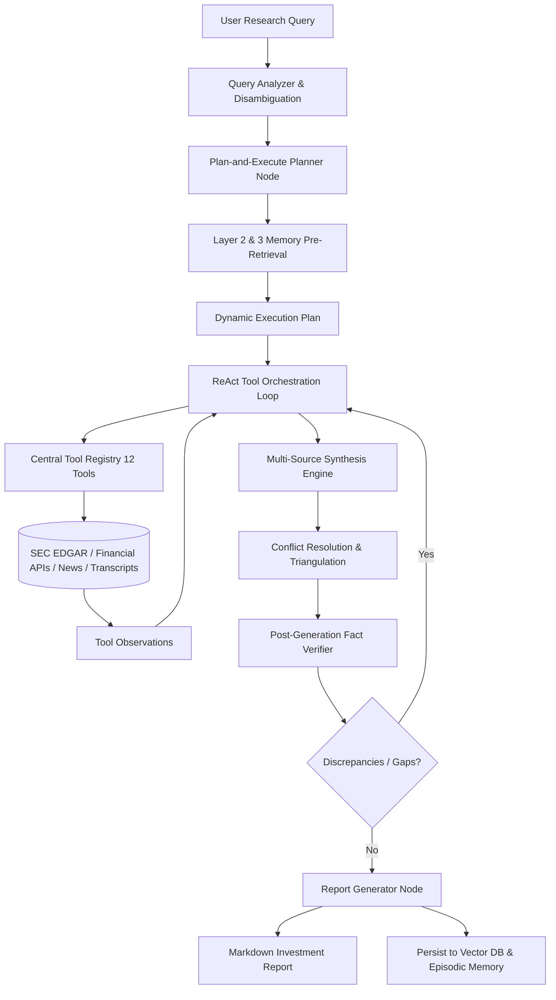
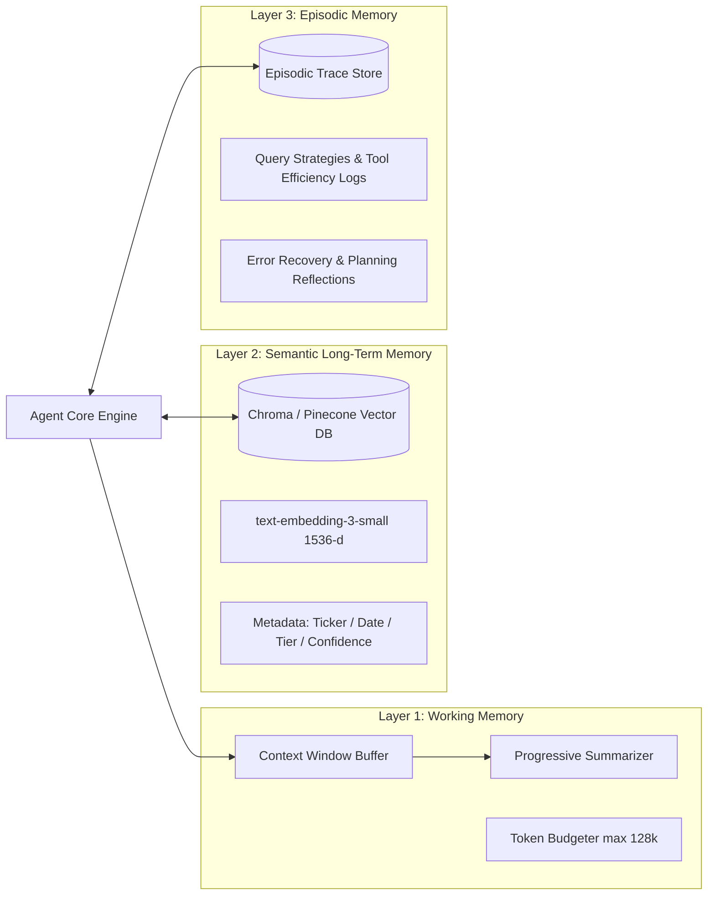
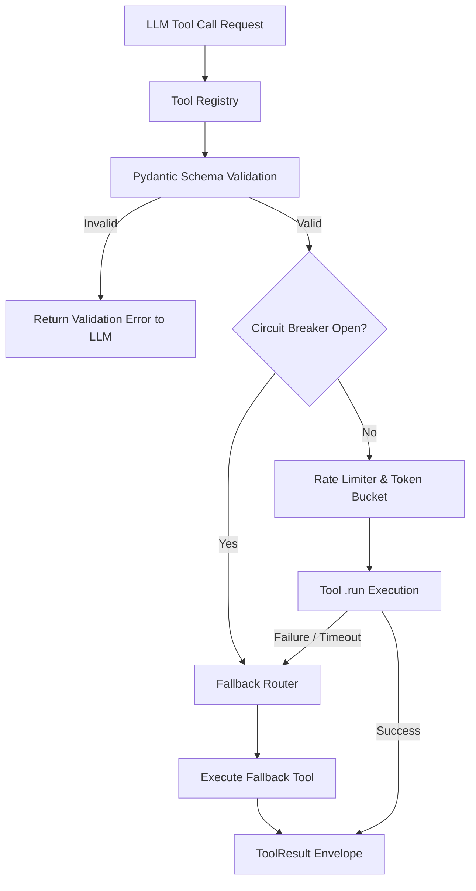
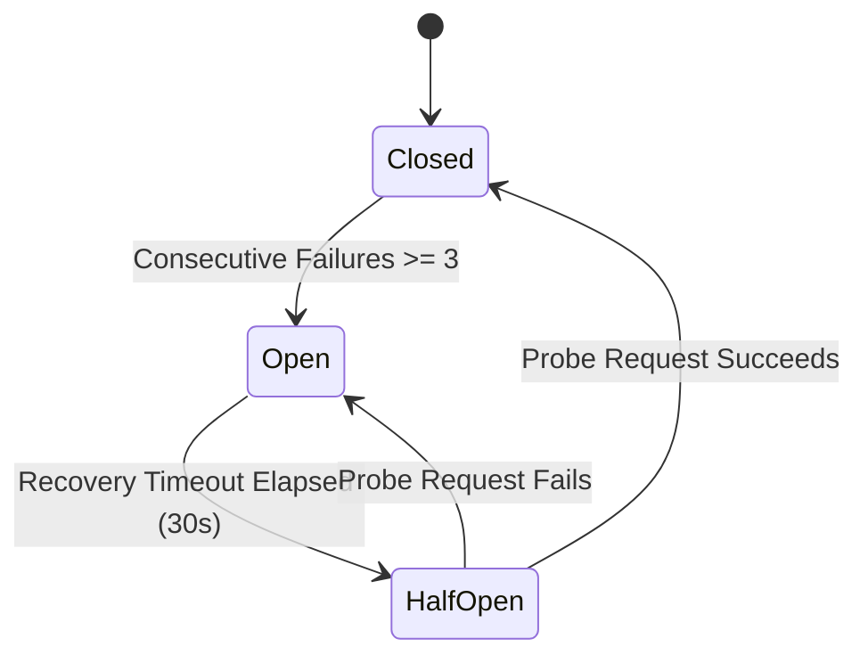
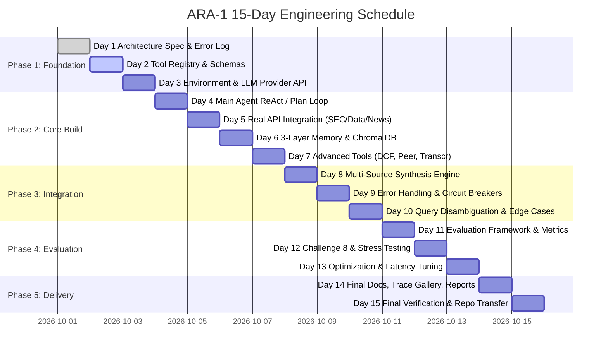

# ARA-1: Autonomous Financial Research Agent
## System Architecture Specification & Technical Blueprint

**Document Reference:** `ARA1-ARCH-SPEC-V1`  
**Project Code:** 1A — Autonomous Financial Research Agent with Multi-Source Synthesis  
**Organization:** QuantumEdge Research / Zetheta Algorithms  
**Author:** AI Systems Engineering Team / Intern  
**Target Platform:** Python 3.10+, LangChain 0.2+, LangGraph 0.1+, ChromaDB, OpenAI / Anthropic APIs  

---

## Table of Contents
1. [Executive Summary & System Objectives](#1-executive-summary--system-objectives)
2. [Agent Cognitive Reasoning Loop](#2-agent-cognitive-reasoning-loop)
   - 2.1 Pattern Selection & Rationale (Hybrid Plan-and-Execute + ReAct)
   - 2.2 LangGraph StateGraph Architecture & Workflow Nodes
   - 2.3 Cognitive Loop Sequence Diagram
3. [Three-Layer Memory Architecture](#3-three-layer-memory-architecture)
   - 3.1 Layer 1: Working Memory (Context Window Management)
   - 3.2 Layer 2: Semantic Long-Term Memory (Vector Database)
   - 3.3 Layer 3: Episodic Memory (Process & Strategy Learning)
   - 3.4 Memory Interplay & Retrieval Pipeline
4. [Central Tool Registry Architecture](#4-central-tool-registry-architecture)
   - 4.1 Registry Architecture & Dispatch Layer
   - 4.2 Comprehensive 12-Tool Specification Catalog
   - 4.3 Fallback Tool Chains & Dynamic Capability Unlocks
5. [Multi-Source Data Synthesis & Conflict Resolution](#5-multi-source-data-synthesis--conflict-resolution)
   - 5.1 Corrected Source Reliability Hierarchy
   - 5.2 Conflict Resolution Protocol
   - 5.3 Quantitative Triangulation & Narrative Threading
6. [Resilience, Circuit Breakers & Graceful Degradation](#6-resilience-circuit-breakers--graceful-degradation)
   - 6.1 Exponential Backoff with Jitter
   - 6.2 Circuit Breaker State Machine
   - 6.3 Graceful Degradation Protocol
7. [Query Disambiguation & Edge Cases](#7-query-disambiguation--edge-cases)
8. [Evaluation Framework & Benchmarking](#8-evaluation-framework--benchmarking)
9. [15-Day Project Roadmap](#9-15-day-project-roadmap)

---

## 1. Executive Summary & System Objectives

The **Autonomous Research Agent (ARA-1)** is designed to automate the labor-intensive workflows of an entry-level equity research analyst at an institutional investment firm. In traditional quantitative and fundamental research environments, an analyst tasked with evaluating an investment opportunity must:
1. Parse ambiguous research queries from portfolio managers;
2. Retrieve primary regulatory disclosures (SEC 10-K, 10-Q, 8-K filings via EDGAR);
3. Pull structured financial statements and key financial ratios;
4. Extract qualitative insights and forward guidance from earnings call transcripts;
5. Monitor macro-economic developments, industry news, and market sentiment;
6. Reconcile conflicting claims across disparate sources;
7. Calculate financial ratios, growth rates, and discounted cash flow (DCF) valuations;
8. Synthesize findings into structured, cited, and defensible investment research reports.

**ARA-1** realizes this workflow as a fully autonomous agentic system. Grounded in a **Plan-and-Execute + ReAct hybrid architecture**, ARA-1 orchestrates a catalog of 12 specialized tools, maintains a 3-layer memory system, executes automated fact-verification, and degrades gracefully in the presence of API outages.



---

## 2. Agent Cognitive Reasoning Loop

### 2.1 Pattern Selection & Rationale: Hybrid Plan-and-Execute with ReAct Sub-Loops
In Section A1 of the project document, two primary paradigms are introduced:
- **ReAct (Reasoning + Acting):** Highly reactive, evaluating Thought $\to$ Action $\to$ Observation at every single step. Highly adaptable, but prone to wandering, redundant queries, circular logic, and context window bloat in complex 15-page reports.
- **Plan-and-Execute:** Formulates an end-to-end plan before tool invocation. Provides macro visibility and token efficiency, but is brittle if unexpected errors or restatements invalidate initial assumptions.

**ARA-1 Architectural Choice:** **Hybrid Hierarchical Architecture**
1. **Macro Layer (Plan-and-Execute):** An LLM Planner breaks down the user query into a Directed Acyclic Graph (DAG) of explicit research sub-goals (e.g., Step 1: Historical Financial Statements; Step 2: Risk Factor Extraction; Step 3: Peer Comparison; Step 4: Earnings Guidance; Step 5: Synthesis).
2. **Micro Layer (ReAct Execution):** For each sub-goal, an Executor node runs a bounded ReAct cycle (max 4 iterations per sub-goal) allowing adaptive tool selection, local retries, and fallback tool usage.
3. **Dynamic Re-Planning:** If an observation invalidates downstream assumptions (e.g., discovery of an undisclosed material acquisition in an 8-K), the state machine triggers the Planner to revise subsequent steps.

### 2.2 LangGraph StateGraph Architecture
The system state is tracked via a typed dictionary persisted across graph checkpoints:

```python
from typing import TypedDict, List, Dict, Any, Optional

class ResearchState(TypedDict):
    query: str
    disambiguated_query: str
    target_ticker: str
    research_depth: str                 # 'quick_brief', 'standard', 'deep_dive'
    plan: List[str]
    current_step_index: int
    gathered_data: Dict[str, Any]       # Keyed by source/domain
    memory_citations: List[Dict[str, Any]]
    conflicts_detected: List[Dict[str, Any]]
    draft_report: str
    verification_passed: bool
    unverified_claims: List[str]
    final_report: str
    tool_call_count: int
    error_log: List[Dict[str, Any]]
```

### 2.3 Cognitive Loop State Transitions
- `query_analyzer_node`: Normalizes tickers, detects ambiguities, and checks temporal anchors.
- `planner_node`: Formulates the structured multi-step plan.
- `memory_consult_node`: Queries the vector database for prior research to avoid redundant API calls.
- `react_executor_node`: Executes the active step using dynamic tool calls.
- `synthesis_node`: Triangulates data, evaluates source credibility, and threads narrative.
- `verification_node`: Verifies numerical claims against raw tool outputs (Chain-of-Verification).
- `reporter_node`: Formats the structured markdown report with citations and degradation disclaimers.

---

## 3. Three-Layer Memory Architecture



### 3.1 Layer 1: Working Memory (Working / Short-Term)
- **Scope:** Active research session context window.
- **Budgeting & Compaction:** When context consumption reaches 75% of context window limits ($~96,000$ tokens on GPT-4o / $150,000$ on Claude 3.5 Sonnet), the `ContextManager` executes **Progressive Summarization**:
  - Raw JSON filings and full transcripts are compacted into high-density quantitative markdown tables.
  - Earlier Thoughts and intermediate observations are collapsed into "Key Findings" bullet points, preserving exact citations and numerical figures.

### 3.2 Layer 2: Semantic Long-Term Memory (Vector Database)
- **Engine:** ChromaDB (local development) with Pinecone cloud migration adapter.
- **Embedding Model:** `text-embedding-3-small` (1,536 dimensions; normalized cosine similarity).
- **Chunking Strategy:**
  - *10-K / 10-Q Filings:* Semantic chunking by section (`Item 1A: Risk Factors`, `Item 7: MD&A`, `Financial Statements`).
  - *Earnings Transcripts:* Chunks bounded by speaker turns, keeping analyst question + executive answer paired.
  - *News Articles:* Paragraph chunking prepended with article headline, publisher, and timestamp.
- **Schema & Metadata:**
  ```json
  {
    "id": "aapl-10k-2024-item1a-003",
    "content": "Supply chain dependencies in Asia Pacific...",
    "ticker": "AAPL",
    "source_type": "10-K",
    "filing_date": "2024-11-01",
    "source_tier": 1,
    "confidence": 0.98,
    "session_id": "sess-2026-09-30-01"
  }
  ```

### 3.3 Layer 3: Episodic Memory (Experience & Strategy Memory)
- **Scope:** Cross-session procedural learning.
- **Payload:** Records query classifications, tool execution success rates, search strategies that yielded high citation densities, and error recovery sequences.
- **Use in Planning:** When a new query arrives (e.g. "Bank Stress Tests"), the Planner checks episodic memory:
  - *Retrieval:* "For banking sector queries, `financial_data_api` balance sheet capital ratios (CET1) combined with regulatory circular search produced 40% higher accuracy than generic web search."
  - *Action:* The Planner prioritizes CET1 ratio extraction in Step 1.

---

## 4. Central Tool Registry Architecture

### 4.1 Registry Architecture & Dispatch Layer
The tool registry serves as the runtime decoupling layer between LLM tool calling and underlying network APIs. Every tool inherits from `BaseTool`, adheres to Pydantic schemas, and is exposed to the LLM via standard OpenAI Function Calling / Claude Tool Use definitions.



### 4.2 Comprehensive 12-Tool Specification Catalog

| # | Tool Name | Category | Primary Function | Input Schema Summary | Fallback Chain |
| :--- | :--- | :--- | :--- | :--- | :--- |
| 1 | `sec_filing_search` | Regulatory | Search & pull 10-K, 10-Q, 8-K filings from SEC EDGAR | `ticker: str, filing_type: str, year: Optional[int]` | `financial_data_api` $\to$ `web_search` |
| 2 | `web_search` | Search | Search web for recent financial news & macro developments | `query: str, num_results: int, date_range: Optional[str]` | `news_sentiment` |
| 3 | `earnings_transcript` | Transcripts | Retrieve quarterly earnings conference call transcript & Q&A | `ticker: str, quarter: str, year: int` | `web_search` $\to$ `sec_filing_search` |
| 4 | `financial_data_api` | Market Data | Pull structured balance sheets, income statements, cash flows | `ticker: str, statement_type: str, period: str, years: int` | `sec_filing_search` $\to$ `web_search` |
| 5 | `news_sentiment` | NLP Sentiment | Score sentiment polarity & key themes in financial press | `query: str, num_articles: int, lookback_days: int` | `web_search` |
| 6 | `vector_db_search` | Memory | Retrieve historical research chunks from long-term memory | `query: str, top_k: int, filter: Optional[dict]` | None (local) |
| 7 | `vector_db_store` | Memory | Persist verified findings into vector database | `content: str, metadata: dict` | None (local) |
| 8 | `company_profile` | Fundamentals | Retrieve sector, industry, market cap, executive roster | `ticker: str` | `web_search` |
| 9 | `peer_comparison` | Valuation | Generate peer valuation matrix across growth & multiple metrics | `ticker: str, num_peers: int, metrics: list[str]` | `company_profile` $\to$ `financial_data_api` |
| 10 | `calculation_engine` | Quantitative | Perform DCF valuations, WACC, CAGR, and financial ratios | `calculation_type: str, inputs: dict` | None (pure deterministic) |
| 11 | `fact_checker` | Verification | Cross-verify numerical claims against multi-source evidence | `claim: str, sources: Optional[list[str]]` | None |
| 12 | `report_generator` | Synthesis | Format verified findings into institutional markdown report | `template: str, sections: dict, sources: list[str]` | None |

### 4.3 Fallback Tool Chains & Progression Unlocks
To satisfy simulation requirements (Section B4.4) while resolving Error #4, the registry supports dynamic locking and unlocking. All prerequisite baseline tools are unlocked at startup, while specialized tools (`earnings_transcript`, `peer_comparison`, `calculation_engine`) feature graceful fallback mappings if invoked before official milestone unlocking.

---

## 5. Multi-Source Data Synthesis & Conflict Resolution

### 5.1 Corrected Source Reliability Hierarchy
In accordance with corrected institutional standards (rectifying Source Document Error #2), data sources are prioritized in strict hierarchical tiers:

$$\text{Tier 1 (SEC Filings)} \succ \text{Tier 2 (Financial APIs)} \succ \text{Tier 3 (Earnings Calls)} \succ \text{Tier 4 (Institutional News)} \succ \text{Tier 5 (Crowdsourced)}$$

```
+---------------------------------------------------------------------------------+
| TIER 1: Statutory Regulatory Filings (SEC 10-K, 10-Q, 8-K; MCA AOC-4 / MGT-7)   |
| Characteristics: Audited, legally binding, criminal penalties for fraud.        |
+---------------------------------------------------------------------------------+
                                      |
                                      v
+---------------------------------------------------------------------------------+
| TIER 2: Professional Financial Databases (Bloomberg, FactSet, Refinitiv, FMP)   |
| Characteristics: Standardized accounting rules, data scrubbing, professional QC.  |
+---------------------------------------------------------------------------------+
                                      |
                                      v
+---------------------------------------------------------------------------------+
| TIER 3: Direct Corporate Communications & Transcripts (Earnings Calls, 8-K PR)  |
| Characteristics: Primary management commentary, forward guidance, subject to PR. |
+---------------------------------------------------------------------------------+
                                      |
                                      v
+---------------------------------------------------------------------------------+
| TIER 4: Tier-1 Financial Journalism (Reuters, Bloomberg News, FT, WSJ)           |
| Characteristics: Rigorous editorial standards, secondary sourcing, fast.        |
+---------------------------------------------------------------------------------+
                                      |
                                      v
+---------------------------------------------------------------------------------+
| TIER 5: Crowdsourced & Unverified Web Feeds (Social Media, Forums, Speculation)  |
| Characteristics: High noise-to-signal, sentiment indicator only. Never a fact.   |
+---------------------------------------------------------------------------------+
```

### 5.2 Conflict Resolution Protocol
When conflicting data points are observed for metric $M$:
1. **Temporal Disambiguation:** Check reporting periods (e.g. FY23 vs TTM vs Calendar Year vs Fiscal Year). 80% of perceived discrepancies stem from misaligned quarterly end dates.
2. **Restatement Identification:** Check for subsequent 10-K/A or 10-Q amendments where historical figures were restated.
3. **Accounting Standards Alignment:** Check GAAP vs Non-GAAP (e.g. Stock-Based Compensation exclusions in EBITDA).
4. **Dominance Rule:** If disagreement persists after steps 1–3, the higher tier strictly overrides the lower tier.
5. **Transparency Logging:** The report must include an explicit disclosure footnote stating both figures, the sources, and the rationale for the accepted value.

### 5.3 Quantitative Triangulation
For core valuation metrics (Revenue, Operating Income, EPS), the agent cross-checks three distinct sources (e.g., 10-K filing, Financial API, Earnings Call). If $|V_{\text{API}} - V_{\text{SEC}}| / V_{\text{SEC}} > 0.02$ (2% discrepancy), an automated verification sub-agent is spawned to isolate the variance.

---

## 6. Resilience, Circuit Breakers & Graceful Degradation

### 6.1 Exponential Backoff with Jitter
All external API communications (SEC EDGAR, FMP, Alpha Vantage, Tavily) are wrapped with `tenacity` retries:
$$t_{\text{wait}} = \min(t_{\text{max}}, t_{\text{base}} \times 2^{\text{attempt}}) + \text{Uniform}(0, 0.5)$$
- `max_attempts`: 4
- `base_delay`: 1.0 second
- `max_delay`: 10.0 seconds

### 6.2 Circuit Breaker State Machine
To prevent cascading latency and quota exhaustion during third-party API outages (e.g., Challenge 8 simulated 50% failure rate):


- **Closed:** Normal traffic flows to primary tool.
- **Open:** Requests immediately divert to fallback chain without calling dead API.
- **Half-Open:** A single probe request tests upstream recovery.

### 6.3 Graceful Degradation Protocol
When primary and fallback tools for a required section fail:
1. **Zero Hallucination Guarantee:** The agent is strictly forbidden from extrapolating or hallucinating missing numbers.
2. **Standardized Disclaimer:** The affected report section is flagged with a prominent degradation banner:
   > `[DATA DEGRADATION NOTICE: Section compiled using secondary news sentiment due to SEC EDGAR API timeout. Confidence Score: 0.62.]`
3. **Alternative Action Guidance:** Provide actionable steps for the human analyst to manually verify the omitted data points.

---

## 7. Query Disambiguation & Edge Cases

Incoming user queries pass through `agent/query_analyzer.py`:
- **Entity Disambiguation:** Resolves company names to primary ticker (e.g. "Amazon" $\to$ `AMZN`, distinguishing from Amazon Rainforest or Amazon River).
- **Segment Isolation:** Parses requests targeting specific corporate units (e.g. "AWS vs Azure vs GCP" parses to segment reporting in AMZN, MSFT, and GOOGL 10-Ks).
- **Temporal Anchor Resolution:** Identifies relative terms ("latest", "post-pandemic", "2008 crash") and anchors them to exact fiscal dates, preventing historical errors (such as confusing the 2009 SCAP stress test timeline).
- **Edge Cases:**
  - *Private Companies (e.g., ByteDance, Stripe):* Immediately informs the user that SEC 10-Ks do not exist, shifts strategy to news, funding rounds, and competitor 10-K commentary.
  - *Recent IPOs:* Detects limited historical filings and substitutes Form S-1 for missing 10-K history.

---

## 8. Evaluation Framework & Benchmarking

ARA-1 incorporates a 20-metric automated and LLM-as-judge evaluation engine:

### 8.1 Metrics Architecture
1. **Factual Accuracy (FA-1 to FA-5):** Numerical accuracy rate (>98%), citation validity (100%), temporal consistency, entity verification, hallucination count (0).
2. **Completeness (CO-1 to CO-4):** Section coverage, data source diversity ($\ge 4$ source types), historical breadth ($\ge 3$ years), risk factor coverage ($\ge 80\%$).
3. **Analytical Depth (AD-1 to AD-4):** Insight density ($\ge 3$ non-obvious points/page), cross-source synthesis points ($\ge 5$), original quantitative calculations ($\ge 10$), forward scenario modeling.
4. **Coherence & Structure (CS-1 to CS-4):** Logical narrative flow, internal consistency (0 contradictions), executive summary fidelity, formatting compliance.
5. **Agent Behavior (AB-1 to AB-5):** Tool call efficiency ($\ge 70\%$), error recovery rate ($\ge 90\%$), planning quality, corrected memory utilization ratio ($\ge 0.30$), overall latency ($<5$ minutes).

### 8.2 Institutional Human Baseline Comparison
Outputs from Challenges 1, 2, and 4 are benchmarked against human junior analyst reports from Goldman Sachs and Morgan Stanley. Scoring uses a 5-point rubric evaluated through blind LLM-as-judge with chain-of-thought grading.

---

## 9. 15-Day Project Roadmap



---
*Authorized for Project 1A Implementation — QuantumEdge Research / Zetheta Algorithms*
